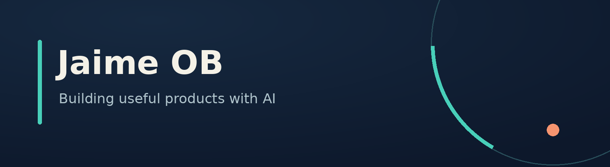

## Hi, I'm Jaime 👋

I build practical digital products with the help of AI, focusing on tools that
make everyday work easier.

### Currently building

**[OpenClaw HUB](https://github.com/jobmaking/openclaw-hub)** — a self-hosted interface that brings OpenClaw agents together,
with a web app and an optional Linux desktop client.

The first community preview is available, with source code and installation guides.
It is an independent community project, not an official OpenClaw product.

### What you'll find here

- Useful tools and self-hosted software.
- AI-assisted workflows and practical automation.
- Lessons from building products and improving them through use.

I prefer simple solutions, clear interfaces and sharing things that genuinely work.
